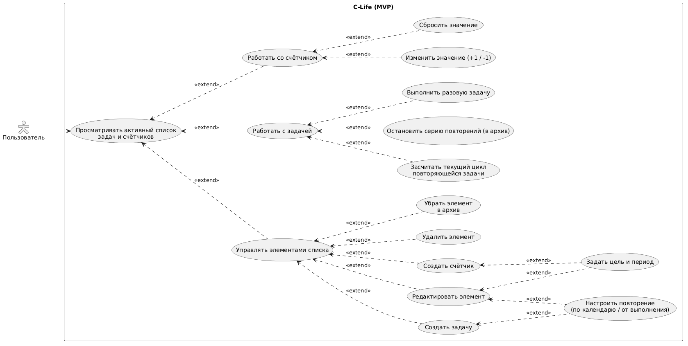
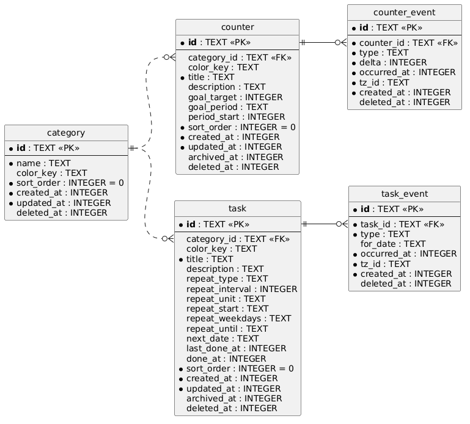

# **C-Life**

Android приложение для жизни

## Идея

Круто, что есть приложения на любой случай жизни. Но большинство из них выполняет одну маленькую задачу. Цель — **собрать** самые частые и полезные **функции в одном месте**.

**Принципы**

- **Скорость.** Записать событие быстрее, чем в заметках (или так быстро, чтобы поймать вдохновение).
- **Отказоустойчивость.** Данные не должны теряться из-за сети, сбоев или закрытия приложения.

**Цель**

Я позиционирую этот проект как способ отработать свои навыки в проектировании ПО. Поэтому упор сделан на планирование, создание диаграм, схем, юзер-кейсов и т.д. и т.п.

## MVP

### Возможности

*У самурая нет цели, только путь.*

У меня нет видения того, как должно выглядеть готовое приложение. Знаю лишь, что оно должно быть модульным. В MVP планируется реализовать первый из них (задачи и счётчики).

* **Счётчики:** `+1` / `-1` по клику, история изменений, прогресс к цели.
* **Задачи:** разовые и повторяющиеся(по календарю или в зависимости от прошлого выполнения)

## Use-case диаграмма

## Схема базы данных

подробнее в docs/arch.md

### Дальше

- [ ] Заметки дня (ежедневник, привязанный к дате)
- [ ] Хроника дня (?)
- [ ] Календарь (?)
- [ ] Интеграции с Notion(?) и Google Calendar(?)